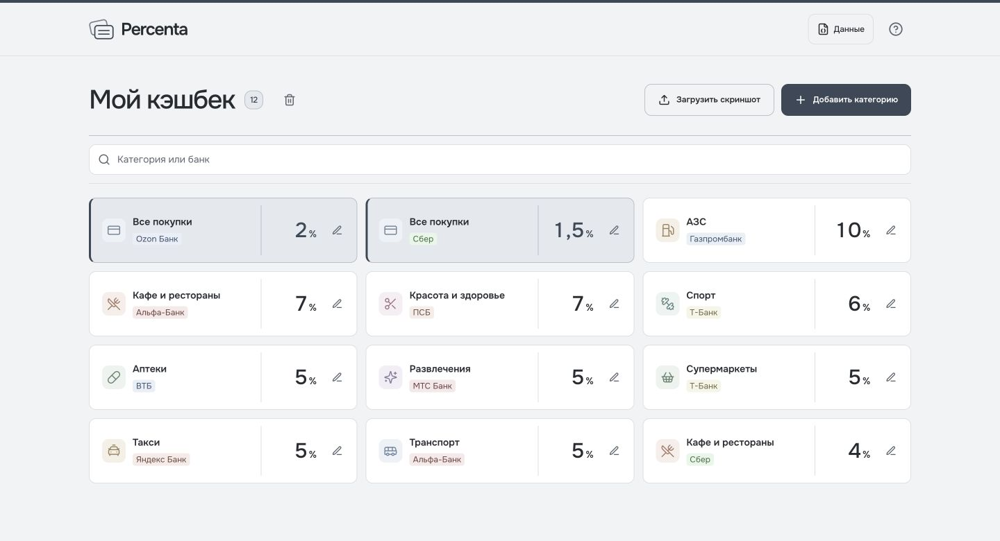
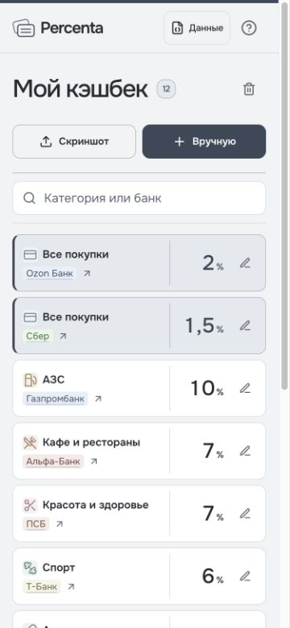

# Percenta

Выбирайте карту, которой выгоднее платить.

Percenta собирает предложения ваших банков, чтобы перед покупкой можно было сравнить кэшбек и не вспоминать, где в этом месяце больше процентов.

[Открыть Percenta](https://percenta.ru)

**Без регистрации и подключения к банковским аккаунтам.**

## Что умеет Percenta

- **Собрать кэшбек из скриншота.** Укажите банк, загрузите снимок с категориями и процентами и проверьте результат.
- **Помочь выбрать карту для покупки.** Найдите нужную категорию и сравните, у какого из ваших банков выше процент кэшбека.
- **Учесть кэшбек на все покупки.** Сравнивайте обычный кэшбек вместе с повышенными предложениями по категориям.
- **Сохранить предложения всех банков.** Одна и та же категория может остаться у нескольких банков — вы сами решаете, какой картой воспользоваться.
- **Обновить условия вручную.** Добавляйте предложения без скриншота, исправляйте распознанное и меняйте проценты, когда банк обновляет условия.
- **Перенести свой набор.** Сохраните предложения в файл и загрузите его на другом устройстве. Копия также поможет восстановить записи после очистки браузера.
- **Перейти к банку с телефона.** Открывайте поддерживаемые банковские приложения и веб-банки прямо из Percenta.

Скриншоты обрабатываются на вашем устройстве, записи кэшбека хранятся в браузере. Перед очисткой его данных сохраните копию. Лимиты и условия начисления проверяйте в банке.

## Пример использования

На скриншотах — вымышленные предложения для демонстрации, а не действующие тарифы банков.

[Запуск и устройство проекта для разработчиков](AGENTS.md).
